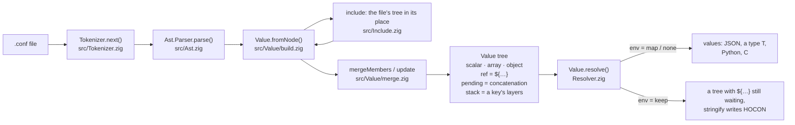
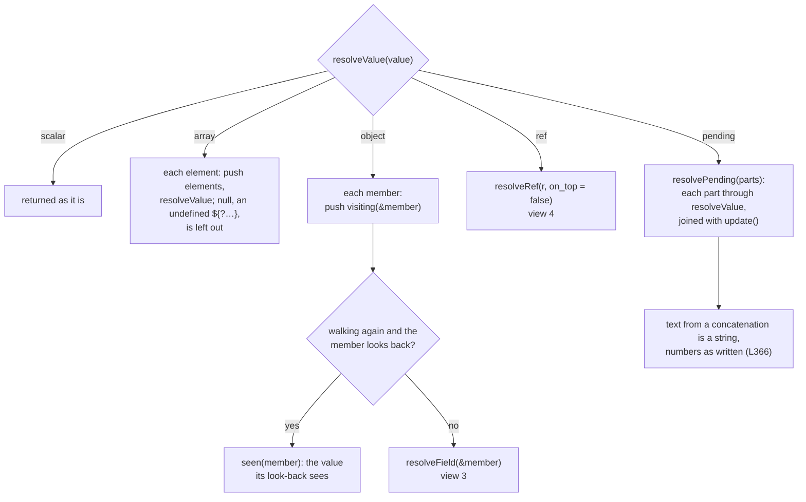
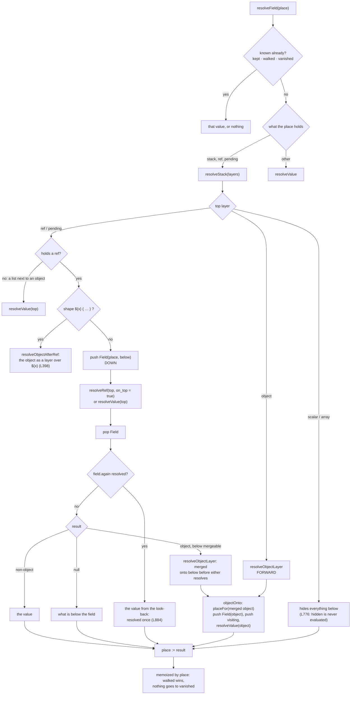
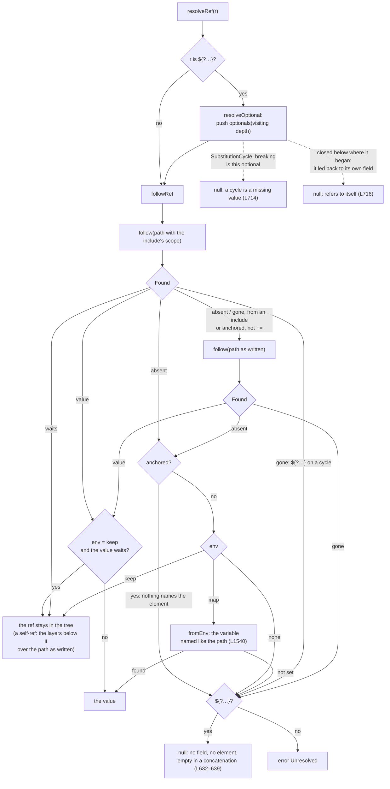
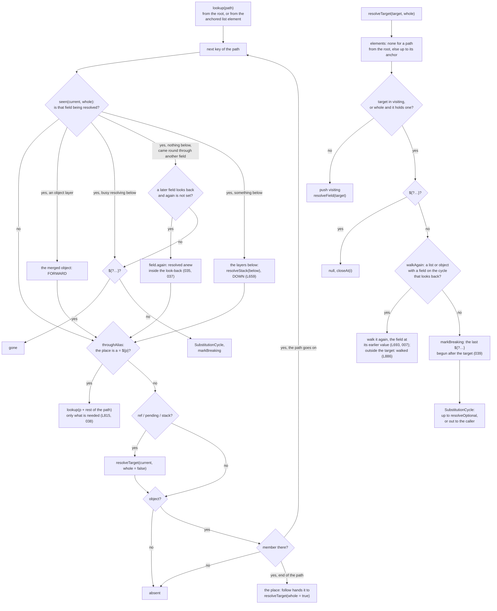

# How substitutions resolve

`src/Value/Resolver.zig` and `src/Value/Resolver/stack.zig`, drawn in five views from the whole to the detail: from file to value, the walk over the tree, a key written more than once, one `${…}`, and a path with the cycles on it. Every node is named after the function that does it, so it can be found in the code. `L…` is a line in [spec/HOCON.md](../spec/HOCON.md), a three-digit number a case in [conformance/suite](../conformance/suite).

## Two rules almost everything follows from

- **A ref looks down.** When the top layer of a field is a `${…}`, or a concatenation with one, a path to that field sees the layers below it, as if the field had never been written from there up. `a = 1`, `a = ${a} x` gives `"1 x"` (L659, L684).
- **An object looks forward.** When the top layer is an object, a path into it sees it merged onto the layers below, along with what is being resolved right now, and resolves only the member it needs. `bar { foo = 42, baz = ${bar.foo} }` (L801, L815).

## 1 · From file to value

- A key written once is a finished value; a key written more than once is a `.stack` of layers, and how they combine is for the resolver to say.
- Objects written one over the other merge while the tree is built. An object over a non-object gets the `hides` flag, so not even an include sees what it replaced.
- A ref built inside a list element carries `flags.anchor`: its path starts at that element, which no path from the root can name. `+=` and the substitutions of a file included there are built that way (L745, L1010).

## 2 · resolveValue: one walk over the tree

- `visiting` is the stack of places being resolved right now; a ref that reaches one of them closes a cycle.
- `elements` is the stack of list elements the walk is in. An object that is an element, or an object part of one, takes the element's entry: it is where an anchored path starts.
- How deep the value is (`depth`) and how long a chain of refs is (`chain`) are bounded by `Ast.max_depth`, beyond which it is `TooDeep`.

## 3 · resolveField and resolveStack: a key written more than once

- A `Field` on the `fields` stack says what a path that reaches the field meanwhile finds: the layers below it, or the merged object (`seen`, view 5).
- `mergeable`: an object on top merges with what is below only when that is an object or looks back. A concatenation with a list or text in it is a list, text or an error, never an object, so an object over it hides it, unevaluated (L384, L778).
- `vanished` remembers a field that resolved to nothing, and whether a cycle made it so: resolved again later, with the cycle over, it would find something, and the result would depend on which field went first.

## 4 · resolveRef: one ${…}

- `absent` means "not in the document", and only that goes on to the environment. `gone` means an optional on a cycle: the field is in the document, so no variable is read.
- A self-reference with nothing below it is `absent`, so it reads the variable of its own name (L767). An anchored path never does.
- **Rule R** (`closed`): an optional whose resolution leads back to the field it stands in, directly or through other fields (L673), is nonexistent (L716), whichever field is resolved first. `f = ${?a.t}x`, `a = ${?y}${?f}` gives `f = "x"`; `b = [${?a}]`, `a = [${?b}]` gives two empty lists (057).

## 5 · lookup, seen and resolveTarget: a path and the cycles on it

- A cycle is found in two places: `seen`, when a path reaches a field being resolved, and `resolveTarget`, when a ref points at a place in `visiting`, or, at the end of its path (`whole`), at an object a place in `visiting` is in. A field that refers to the object it is in is the cycle of L688–691: `a { b = ${a} }`.
- It is broken in three ways: by looking down (`seen` with layers below the field), by resolving anew (`again`, `walkAgain`), or by an optional, which then finds nothing (`breaking`, `closed`, `resolveOptional`).
- A ref that reaches a field being resolved *came round* to it only through another field a ref led to (`targets`), or one resolved after it outside its value (`cameRound`); from inside the field's own value, an include there, it did not. An optional that reaches a field busy looking back at its layers, or an object holding one, is that look-back's business and finds nothing alone (`lookingBack`, `lookingBackIn`): `b.c += ${y}`, `b.c += 2`, `y = [1, ${?b}]` keeps `[[1], 2]`.
- What was resolved inside a look-back is that substitution's value (`walked`, `field.again`): a substitution is resolved once (L884, L886), so the result does not depend on which field went first.
